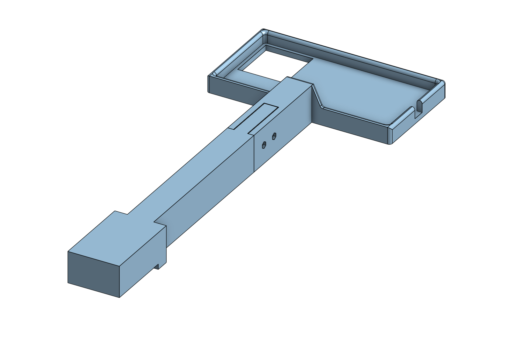
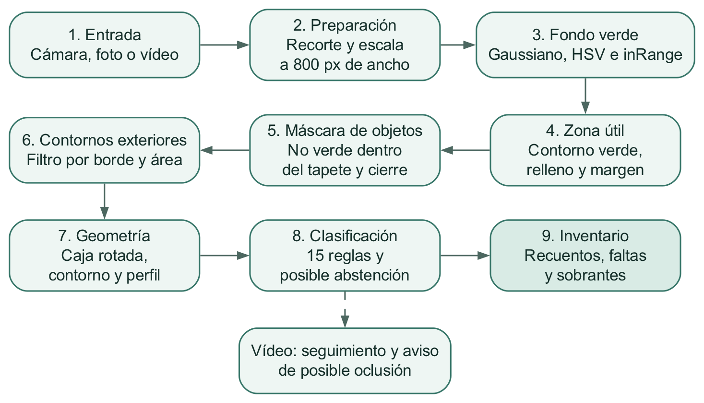
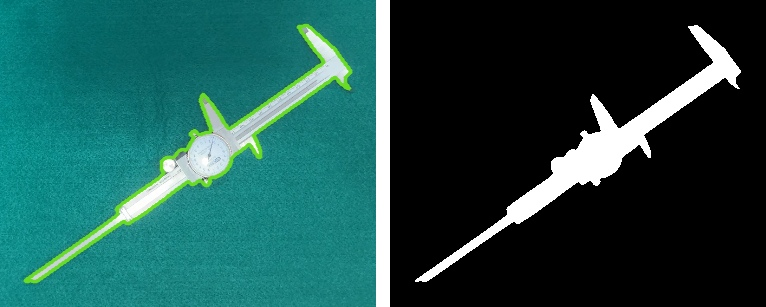
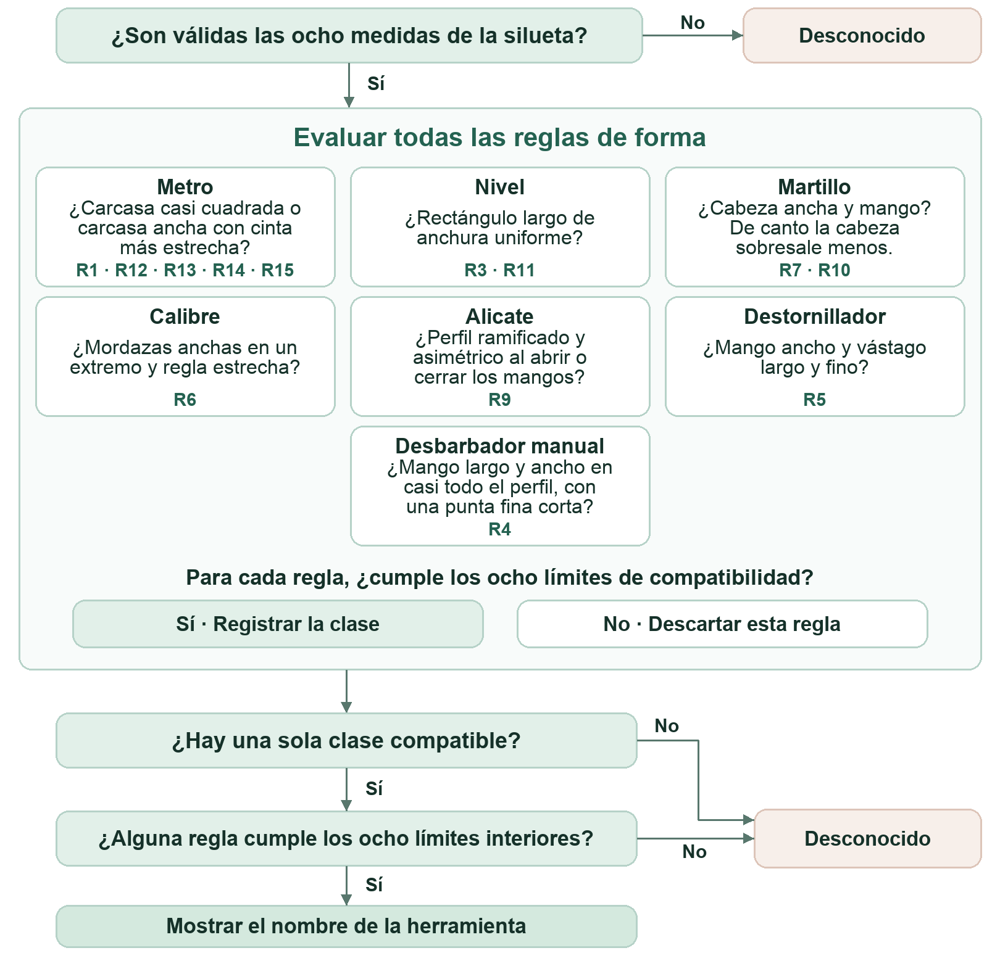

# Inventario de herramientas mediante visión artificial clásica

**Reto 07 · Examen parcial de Inteligencia Artificial**

**Borrador para revisión · 16 de noviembre de 2026**

**Autor, grupo y centro** · Pendientes de completar

**Vídeo de demostración** · Pendiente de publicar en YouTube con la cuenta universitaria e insertar aquí su enlace.

**Datos de prueba** · Pendiente de incluir el enlace al Google Drive de la cuenta de alumno.

Una cámara cenital observa herramientas sobre un tapete verde. El programa separa las siluetas, identifica cada pieza con reglas geométricas y compara las cantidades observadas con un inventario esperado. La aplicación permite usar la cámara en directo y reproducir grabaciones para repetir una prueba.

<!-- pagina -->

## 1. Contextualización del problema y requisitos

El reto tiene tres niveles. El primero localiza los objetos del tapete. El segundo asigna un tipo a cada objeto a partir de su geometría. El tercero interpreta la escena con un inventario que señala ausencias y excesos respecto de las cantidades previstas.

El reto pide entre cinco y ocho tipos distinguibles por silueta, con orientación arbitraria sobre el plano. El perfil de entrega espera una unidad de cada clase: **martillo, destornillador, alicate, calibre, nivel, metro y desbarbador manual**. Las pruebas deben variar posición, orientación y combinación de herramientas. Para comparar formas se usa el eje de la caja rotada. Colocar una pieza de canto o abrirla también cambia su silueta, por lo que algunas posturas tienen reglas propias.

## 2. Montaje físico

| Elemento | Configuración y motivo |
|---|---|
| Cámara | Un iPhone en posición cenital fija, aproximadamente perpendicular al tapete. Así se reduce la perspectiva y se puede mover o girar una pieza conservando una vista comparable. Completar modelo, lente y altura desde el tapete. |
| Soporte | Soporte impreso en 3D adaptado para pasar el cable. Añadir fotografía lateral y cenital del montaje final. |
| Conexión y equipo | Mac con Cámara de Continuidad. La aplicación ofrece captura por USB y conexión inalámbrica a través de macOS. Completar modelo del Mac y modo usado en la evaluación final. |
| Fondo | Tapete verde mate para separar fondo y herramientas por HSV. Verificar cobertura aproximada de 0,50 × 0,50 m y encuadre con fondo uniforme. Anotar las medidas reales. |
| Iluminación (opcional) | Indicar si se usó luz ambiental o una fuente auxiliar, su posición y las condiciones de la prueba. Revisar sombras y reflejos, especialmente sobre el calibre. |
| Adquisición | Un vídeo de desarrollo está registrado a 1920 × 1080 y 15 fps nominales. El software procesa a 800 px de ancho. Medir la resolución efectiva, la escala en px/mm y el detalle más fino visible en el montaje final. |

[Ver el ensamblaje del soporte en Onshape](https://cad.onshape.com/documents/759dbadcb9a06df33c93ec9b/w/7ed87b7afaf41b6273386e73/e/9ada5cc0c2c5625f0e29c0c6?renderMode=0&uiState=6afb11c91d124eb20b1014e9)

<!-- pagina -->

## 3. Diagrama del pipeline completo

## 4. Método de segmentación

La entrada de OpenCV se recibe en BGR. Tras el recorte central opcional y el redimensionado, el suavizado reduce variaciones locales y se convierte la imagen a HSV. `inRange` marca el verde. Se rellena el mayor contorno verde para delimitar el tapete y se toma como candidata la parte que difiere del verde dentro de esa región.

El cierre conecta pequeños cortes de la máscara. La apertura está desactivada en los ajustes guardados. Después se vuelve a aplicar la región útil, se extraen los contornos exteriores y se descartan las áreas pequeñas y los componentes que tocan el límite de la zona útil. Si falta una región válida del tapete, la interfaz avisa de que el inventario está sin comprobar.

<!-- pagina -->

## 5. Características extraídas

Los ocho cocientes siguientes alimentan las reglas. El detector también calcula medidas auxiliares para describir dónde está cada silueta y dibujarla.

| Rasgo | Cálculo y utilidad |
|---|---|
| AR · Relación de aspecto | Lado largo / lado corto de la caja rotada. Separa cuerpos compactos de cuerpos alargados. |
| S · Solidez | Área / área de la envolvente convexa. Mide cuánto espacio dejan mordazas, ramas y otras concavidades. |
| C · Circularidad | 4π × área / perímetro². Distingue formas compactas de perfiles largos o irregulares. |
| E · Extensión | Área / área de la caja rotada. Distingue un rectángulo lleno de una figura con tramos estrechos. |
| K · Contraste de extremos | Diferencia entre las anchuras medias del primer y último 20 %, dividida por la mayor de las dos. Distingue un extremo grueso de uno fino. |
| F · Fracción ancha | Proporción de secciones con anchura normalizada de al menos 0,5. Mide cuánto se extiende la parte ancha. |
| A · Asimetría longitudinal | Media de las diferencias absolutas entre el perfil y el perfil invertido. Mide la diferencia entre ambas mitades. |
| W · Ancho central | Anchura media entre el 40 % y el 60 % del eje largo, normalizada por el lado corto. Ayuda a distinguir mangos, varillas y cintas. |
| Área y perímetro | Superficie encerrada (px²) y longitud (px) del contorno exterior. El área filtra partículas y ayuda a asociar pistas. |
| Centroide | Coordenadas en píxeles a partir de momentos del contorno. Sirve para ordenar las detecciones y asociarlas entre fotogramas. |
| Dimensiones y orientación | Lados de la caja rotada en píxeles y ángulo de su eje largo en [0°, 180°). Sirven para inspección y para normalizar el perfil. |

La anchura se mide entre los extremos visibles del contorno en 40 cortes perpendiculares al eje largo. La caja rotada y la normalización permiten comparar giros y tamaños. Los huecos interiores se quedan fuera de los rasgos de contorno exterior.

**Ejemplo del subárbol R6.** Las dos columnas de límites proceden del subárbol del calibre. Los valores observados pertenecen al calibre de la figura 3. Cumple las ocho condiciones interiores de R6 y ninguna otra clase es compatible.

| Rasgo | Observado | Compatible (incluye extremos) | Interior (excluye extremos) |
|---|---|---|---|
| AR | 4,5596 | 2,35 a 6,15 | 2,65 a 5,85 |
| S | 0,3929 | 0,26 a 0,67 | 0,30 a 0,63 |
| C | 0,0908 | 0,02 a 0,27 | 0,06 a 0,23 |
| E | 0,2645 | 0,16 a 0,45 | 0,20 a 0,41 |
| K | 0,7579 | 0,53 a 0,87 | 0,57 a 0,83 |
| F | 0,1250 | 0,04 a 0,32 | 0,08 a 0,28 |
| A | 0,2128 | 0,10 a 0,37 | 0,14 a 0,33 |
| W | 0,3900 | 0,10 a 0,57 | 0,14 a 0,53 |

<!-- pagina -->

## 6. Árbol de decisión utilizado

Las reglas están escritas en [`_REGLAS` de `src/herramientas/vision/clasificacion.py`](../src/herramientas/vision/clasificacion.py#L97). Los perfiles resumen las variantes de cada clase. Por ejemplo, la cabeza ancha y el mango del martillo se traducen en una relación de aspecto de 2,5 a 4,5, un contraste de extremos de 0,25 a 0,55 y un ancho central de 0,28 a 0,45, además de los otros cinco intervalos de R7.

El programa valida las ocho medidas, evalúa todas las reglas y reúne las clases compatibles. Solo confirma una clase si es la única compatible y alguna de sus variantes cumple los ocho límites interiores. Si encajan varias clases o ninguna, o si el único candidato queda en la banda de tolerancia, devuelve **Desconocido**.

La tabla de la sección 7 contiene los intervalos de las siete clases de entrega. En **Entrega → Ver árbol y condiciones** se puede consultar la decisión completa que la web genera desde el código.

<!-- pagina -->

## 7. Justificación experimental de parámetros y umbrales

**Segmentación.** Se repitió el procesamiento sobre tres capturas iniciales de la misma disposición, con seis herramientas en cada una. Se emplearon los archivos `original_20261016_*.png` terminados en `113207_730520`, `113218_711279` y `113231_782061`. Se cambió un ajuste cada vez, manteniendo el resto como en `config/configuracion.json`. Los recuentos indican componentes extraídos por el detector.

| Operación | Valor guardado | Motivo y comparación |
|---|---|---|
| Recorte y escala | Zoom 100 % y ancho 800 px | A 640, 800 y 1024 px salieron seis objetos por foto al reajustar área mínima y margen a cada escala. Se conservan 800 px. Falta comparar detalle fino y velocidad en directo. |
| Gaussiano | 3 × 3 | Los tamaños 1, 3 y 5 dieron seis objetos por imagen. En la segunda foto, el área del contorno menor fue 1130, 1059 y 1052 px² respectivamente. Se conserva el filtro pequeño. |
| Umbral HSV | H 80–100, S 100–255, V 40–255 | A partir de 6/6/6, bajar H máximo a 90 dio 5/3/5. Bajar S mínimo a 60 dio 5/5/5 y bajar S máximo a 200 dio 0/0/0. Subir V mínimo a 80 dio 4/4/5. El rango se debe verificar con la iluminación final. |
| Región del tapete | Mínimo 10 % de la imagen y 25 % de verde en ella | Con región hubo 6/6/6 componentes. Sin región hubo 1/1/1, formado por el exterior. Los dos mínimos son comprobaciones de plausibilidad pendientes de comparar por separado. |
| Margen interior | 2 px y descarte de contornos que tocan el borde útil | Con 0 y con 2 px se obtuvieron seis por imagen. Se conserva el margen para ignorar el borde irregular y las siluetas posiblemente recortadas. |
| Apertura | 0 iteraciones | Una iteración mantuvo seis objetos por foto, pero redujo de 1059 a 1044 px² el contorno menor de la segunda. Se conserva la configuración que erosiona menos las piezas finas. |
| Cierre y elemento estructurante | 1 iteración, elipse 3 × 3 | En la segunda foto, sin cierre hubo 30 571 píxeles de máscara, con el cierre actual 30 711 y con elipse 5 × 5, 31 100. Las tres variantes devolvieron seis objetos. Se usa la ventana pequeña para limitar cuánto se rellena. |
| Área y contornos | 1000 px² y contornos exteriores | Con 1000 px² salieron 6/6/6. Subir a 1200 dio 5/5/5 y excluyó el desbarbador, de 1059 a 1097 px². Los contornos exteriores evitan contar huecos como objetos. |

**Geometría y vídeo.** El perfil usa 40 secciones, con el 20 % del largo para cada extremo y el 20 % central para W. Una sección cuenta como ancha desde la mitad del lado corto. Son elecciones manuales de representación. Falta comparar densidades de muestreo y medir la sensibilidad de los parámetros temporales con escenas reservadas.

<!-- pagina -->

## 7. Justificación experimental de parámetros y umbrales (continuación)

**Clasificación.** Se eligieron intervalos comparando siluetas y mediciones de desarrollo. El calibre inicial tenía centro normalizado 0,208–0,213 y contraste de extremos 0,630–0,691, frente a 0,307–0,315 y 0,443–0,455 en el martillo. Por eso R6 y R7 combinan ambas medidas. Tras observar que el alicate abierto perdía solidez, extensión y anchura central y reducía su AR, R9 amplió estos cuatro intervalos. Las variantes de canto del martillo y el nivel tienen reglas separadas. En once extensiones nuevas del metro, revisar R12–R15 elevó el acierto de 1/11 a 11/11. El historial de mediciones por clase está en `docs/REGLAS.md`.

| Regla / clase | AR | S | C | E | K | F | A | W |
|---|---|---|---|---|---|---|---|---|
| R1 Metro | 1 a 2,2 | 0,9 a 1 | 0,65 a 0,9 | 0,75 a 1 | 0 a 0,25 | 0,85 a 1 | 0 a 0,2 | 0,8 a 1 |
| R3 Nivel | 4 a 6,5 | 0,9 a 1 | 0,25 a 0,5 | 0,85 a 1 | 0 a 0,15 | 0,9 a 1 | 0 a 0,12 | 0,8 a 1 |
| R4 Desbarbador | 8,5 a 14 | 0,7 a 0,95 | 0,1 a 0,25 | 0,55 a 0,85 | 0,55 a 0,95 | 0,65 a 0,9 | 0,15 a 0,5 | 0,7 a 1 |
| R5 Destornillador | 5,5 a 9 | 0,5 a 0,78 | 0,08 a 0,2 | 0,25 a 0,5 | 0,7 a 1 | 0,3 a 0,55 | 0,4 a 0,75 | 0,12 a 0,45 |
| R6 Calibre | 2,5 a 6 | 0,28 a 0,65 | 0,04 a 0,25 | 0,18 a 0,43 | 0,55 a 0,85 | 0,06 a 0,3 | 0,12 a 0,35 | 0,12 a 0,55 |
| R7 Martillo | 2,5 a 4,5 | 0,35 a 0,65 | 0,1 a 0,27 | 0,25 a 0,48 | 0,25 a 0,55 | 0,1 a 0,32 | 0,06 a 0,25 | 0,28 a 0,45 |
| R9 Alicate | 1 a 4 | 0,28 a 0,78 | 0,08 a 0,25 | 0,18 a 0,65 | 0,55 a 0,85 | 0,5 a 0,82 | 0,3 a 0,6 | 0,54 a 0,95 |
| R10 Martillo | 6,5 a 12 | 0,6 a 0,84 | 0,12 a 0,24 | 0,48 a 0,8 | 0 a 0,3 | 0,55 a 1 | 0,07 a 0,21 | 0,43 a 0,75 |
| R11 Nivel | 7 a 15 | 0,88 a 1 | 0,14 a 0,3 | 0,8 a 0,96 | 0 a 0,2 | 0,85 a 1 | 0 a 0,14 | 0,85 a 1 |
| R12 Metro | 2,2 a 10 | 0,25 a 0,68 | 0,025 a 0,3 | 0,13 a 0,45 | 0,65 a 1 | 0,08 a 0,48 | 0,17 a 0,78 | 0 a 0,14 |
| R13 Metro | 1 a 2,2 | 0,78 a 0,91 | 0,45 a 0,61 | 0,55 a 0,72 | 0,88 a 1 | 0,65 a 0,82 | 0,32 a 0,57 | 0,85 a 1 |
| R14 Metro | 2,3 a 4,6 | 0,8 a 1 | 0,34 a 0,6 | 0,65 a 0,85 | 0,35 a 0,62 | 0,48 a 0,82 | 0,24 a 0,45 | 0,6 a 1 |
| R15 Metro | 3,8 a 20 | 0,63 a 0,9 | 0,04 a 0,44 | 0,4 a 0,72 | 0,35 a 0,68 | 0,07 a 0,65 | 0,1 a 0,45 | 0,34 a 0,84 |

La compatibilidad amplía cada extremo por 0,15 en AR o 0,02 en los demás cocientes. La aceptación interior estrecha el intervalo por el mismo margen. Los límites físicos 0 y 1, y el mínimo físico AR = 1, quedan incluidos cuando coinciden con un extremo de la regla. Las bandas son tolerancias manuales. Falta compararlas en escenas nuevas.

**Inventario.** Se cuentan las detecciones identificadas del fotograma y se comparan con las cantidades esperadas. Una diferencia negativa indica ausencia o falta de unidades y una positiva indica repetición o sobrante. Los objetos sin identificar dejan la comparación provisional.

**Seguimiento.** Las pistas se asocian por proximidad, con un máximo de 80 px, y por un cociente de áreas entre 0,5 y 2. El seguidor admite hasta 5 fotogramas perdidos. En la web, si la última silueta reconocida conserva evidencia en su zona y la identificación se interrumpe, se señala una posible oclusión en ámbar durante hasta 1,5 s. Se exige que la máscara ocupe al menos el 35 % de la silueta previa. Si hubo descartes en el borde, se permite comprobar un pequeño margen con una dilatación de 11 × 11 px. La detección actual y la estimación se cuentan por separado.

**Límites.** El contacto entre piezas, el recorte, los reflejos y la oclusión pueden alterar el contorno. Queda por medir cuánto afectan en escenas nuevas los parámetros de seguimiento y las bandas de abstención.

<!-- pagina -->

## 8. Resultados sobre un conjunto de pruebas

La revisión del 16 de noviembre reproduce **102 identificaciones correctas en 102 referencias confirmadas de desarrollo** de las siete clases de entrega. El conjunto contiene objetos ya detectados y etiquetados y formó parte de la revisión de las reglas.

| Herramienta | Referencias de desarrollo | Identificaciones correctas |
|---|---|---|
| Alicate | 9 | 9 |
| Calibre | 18 | 18 |
| Desbarbador manual | 15 | 15 |
| Destornillador | 9 | 9 |
| Martillo | 13 | 13 |
| Metro | 26 | 26 |
| Nivel | 12 | 12 |
| **Total del perfil** | **102** | **102** |

Dos fallos observados guiaron cambios concretos. En los tres encuadres amplios de la sección 7, el exterior formaba un único contorno sin delimitar el tapete. Entre las once nuevas extensiones del metro, el clasificador anterior se abstuvo diez veces y el actual reconoció las once. Las capturas y etiquetas de ambos casos pertenecen a desarrollo.

## 9. Medida cuantitativa de aciertos y errores

En las referencias de desarrollo de estas siete clases hubo **102/102 aciertos de clasificación, 0 nombres erróneos y 0 abstenciones**. La métrica se calcula sobre las siluetas etiquetadas. Las omisiones y las detecciones espurias se miden evaluando todas las herramientas reales de cada escena.

A fecha de este borrador hay **0 escenas independientes registradas**. Para completar el resultado, conservar escenas nuevas con ajustes fijos y variar número, posición, orientación y combinaciones. Incluir tapete vacío, una retirada, una reposición y, si hay dos ejemplares reconocibles de una misma clase, una repetición física. Anotar la realidad de cada escena, incluidas las piezas que el sistema omita.

| Medida de evaluación final | Cálculo o criterio | Resultado |
|---|---|---|
| Precisión de detección | Detectados correctos / total detectado | Pendiente |
| Exhaustividad de detección | Detectados correctos / total real | Pendiente |
| Acierto de clasificación | Clases correctas / detecciones asociadas | Pendiente |
| Acierto extremo a extremo | Clases correctas / objetos reales | Pendiente |
| Inventario y avisos | Escenas con inventario exacto y avisos correctos / escenas evaluables, por separado | Pendiente |

Registrar TP (detección real asociada), FP (detección sin correspondencia), FN (herramienta omitida), nombre incorrecto y resultado desconocido. Añadir uno o dos ejemplos de error y su causa observada. Reservar la adquisición completa, agrupando los fotogramas de cada clip para evitar que material usado al ajustar también se presente como prueba independiente.

<!-- pagina -->

## Software y hoja de ruta

El entorno documentado usa Python 3.13, OpenCV 5.0 y NumPy. OpenCV se ocupa de la captura, el filtrado, las máscaras y los contornos. NumPy calcula y normaliza medidas geométricas. Streamlit sirve la interfaz local de calibración, evaluación y presentación. Los ajustes, etiquetas e informes se guardan en JSON y CSV. Las versiones se fijan en `requirements-web.txt`.

1. Se delimitó el tapete y se calibró su rango de color con imágenes propias.
2. Se etiquetaron ejemplos y se midieron rasgos para redactar reglas manuales.
3. Se añadieron variantes al observar fallos con herramientas abiertas, extendidas o de canto.
4. Se integraron la captura, el inventario y la vista de presentación. La evaluación reservada se realiza con el montaje y los ajustes definitivos.

## 10. Código fuente y otras tareas

El código fuente comentado se entrega junto al PDF. Las funciones clave del programa están en `src/herramientas/`.

| Archivo | Función en el programa |
|---|---|
| `vision/vision.py` | `procesar_imagen` convierte a HSV, delimita el tapete y extrae contornos y medidas básicas. |
| `vision/geometria.py` | `caracteristicas_forma` calcula los cocientes derivados de la caja y del perfil. Los comentarios explican las intersecciones de cada sección con el contorno. |
| `vision/clasificacion.py` | `clasificar_objeto` valida los rasgos, recorre las quince reglas y devuelve clase, estado y ruta de decisión. |
| `vision/arbol.py` | `diagrama_decision` y `diagrama_regla` generan los diagramas DOT a partir de las reglas del clasificador. |
| `vision/reconocimiento.py` | Compara recuentos por clase con las cantidades esperadas y prepara la vista de reconocimiento. |
| `media/directo_web.py` y `web/app_web.py` | Captura de vídeo para la web y entrada de la aplicación local. |
| `datos/evaluacion_escenas.py` | Calcula las métricas con listas completas y correspondencias revisadas. |

Desde la raíz, `./iniciar_web.command` abre la aplicación. **Presentación** muestra nombres e inventario en directo. **Entrega** contiene la evaluación y los árboles. `./ejecutar.sh pruebas` comprueba el software.

En este entorno pasaron las 165 pruebas automáticas del repositorio. El recuento corresponde a pruebas de software.

**Uso crítico del LLM.** Se usó para redactar el borrador, organizar las tablas y preparar las figuras. En la revisión se contrastaron las preguntas del diagrama con las reglas del código, se repitieron las comparaciones de segmentación en las capturas originales y se comprobó qué resultados procedían de ajustes de desarrollo. Para cerrar la memoria se deben verificar las medidas y fotografías del montaje, incorporar la evaluación reservada y completar los enlaces de portada.
