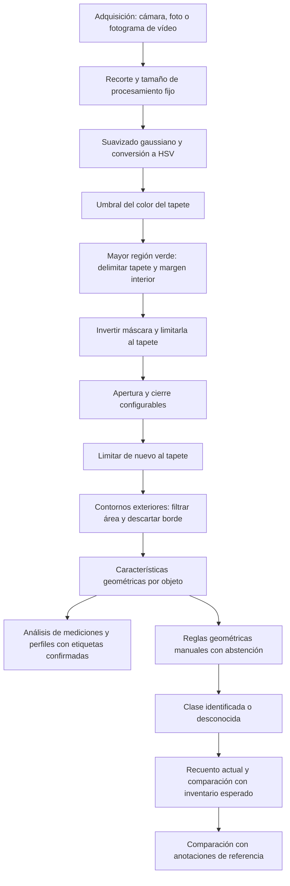
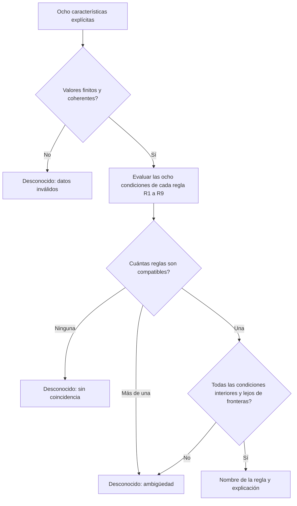

# Reto 07: inventario de herramientas mediante visión clásica

**Borrador de trabajo — 26 de octubre de 2026.** Están implementadas la segmentación, la extracción de características, la clasificación por reglas geométricas manuales y el inventario por escena. La web aplica esas reglas a fotos y vídeos y permite compararlas con etiquetas de referencia. El modo `directo.py` aplica ahora las mismas reglas al flujo de cámara y muestra nombres, pistas, recuentos y FPS observados. La comprobación actual tiene 55 aciertos sobre 55 objetos de desarrollo, sin muestras independientes. Faltan la validación física del nuevo modo en directo con el iPhone, la evaluación con escenas nuevas, completar las medidas del montaje y decidir el alcance de clases de la entrega. Este documento no presenta el proyecto como terminado.

## 1. Objetivo y alcance

Para desarrollar sin cámara, `directo.py --ultimo-video` o `--video RUTA`
sustituye la fuente por un archivo secuencial en el mismo bucle de procesamiento.
La reproducción respeta los FPS nominales cuando el procesamiento lo permite y
no omite imágenes para compensar retrasos. Permite pausa, reinicio y exportación
del fotograma con su procedencia. La vista indica «VIDEO SIMULADO»: comprueba el
procesamiento, pero no valida latencia, permisos ni conectividad del iPhone.

El sistema debe localizar herramientas sobre un tapete verde, identificar entre cinco y ocho tipos mediante características geométricas y un árbol de decisión o reglas explícitas, y generar un inventario con herramientas ausentes o repetidas. Debe admitir posiciones y orientaciones arbitrarias. Se emplean técnicas clásicas de procesamiento de imagen y reglas justificadas mediante mediciones; no se utilizan clasificadores aprendidos ni redes neuronales.

El prototipo reconoce las siguientes nueve clases; no todas aparecen a la vez:

| Clase de trabajo | Unidad que se pretende contar | Observación |
|---|---|---|
| Destornillador | Un destornillador | Conservar la varilla fina y su unión con el mango. |
| Calibre | Un calibre | Su geometría incluye mordazas y una escala alargada. |
| Desbarbador manual | Un desbarbador | Herramienta de punta curva; tipo confirmado por el usuario. |
| Martillo | Un martillo | Cabeza ancha y mango alargado. |
| Juego de llaves Allen | El juego completo en su soporte | Las llaves montadas se consideran un objeto; no se cuentan individualmente. |
| Nivel | Un nivel | Silueta alargada y aproximadamente rectangular. |
| Metro | Un flexómetro recogido | El cuerpo compacto observado; no se ha validado con la cinta extendida. |
| Cuter | Un cúter en la configuración observada | Se conserva el nombre del catálogo del usuario; no se ha validado abierto. |
| Alicate | Un alicate | La regla describe la apertura observada, no todas sus posibles posiciones. |

El enunciado pide entre cinco y ocho tipos; el prototipo actual contiene nueve. Antes de la entrega se debe acordar qué clases forman el alcance final o consultarlo con el docente, sin borrar etiquetas ni datos existentes. Las reglas describen los ejemplares y configuraciones observados. El funcionamiento con objetos separados no demuestra todavía capacidad para resolver solapamientos o contactos ni reconocer cualquier ejemplar de una categoría.

## 2. Montaje físico

La adquisición utiliza un iPhone conectado al Mac mediante Cámara de Continuidad. El calibrador admite imágenes guardadas y la grabación de vídeo limpio de la cámara. La interfaz web reproduce las fotografías y los vídeos guardados, lo que permite ajustar y desarrollar el procesamiento sin la cámara conectada.

El lanzador `iniciar_directo.command` abre `directo.py`, que activa el reconocimiento en el mismo bucle de captura del calibrador. Cada imagen se segmenta con `vision.py`, se asocia mediante `seguimiento.py` y se clasifica con `clasificacion.py`. El inventario se recalcula por fotograma, sin acumular herramientas que ya no se ven. El archivo opcional `--inventario` define cantidades esperadas; no se deducen del catálogo. Las teclas G/R conservan fotos y vídeos limpios, y E añade predicciones separadas de las etiquetas manuales al paquete de resultados. Se mide la frecuencia observada del bucle sin prometer tiempo real a una frecuencia fija. Ante pérdida de imagen se reinicia el seguimiento; si no vuelve en cinco segundos se termina con error y se libera la cámara.

La escena disponible muestra las herramientas sobre un tapete verde azulado. Para la entrega se debe documentar y verificar el montaje completo:

| Elemento | Estado y comprobación pendiente |
|---|---|
| Tapete | Comprobar y fotografiar una zona útil de al menos 0,50 × 0,50 m, mate y visible por completo. |
| Cámara | Anotar modelo, resolución de captura, lente y posición fija, cenital y aproximadamente perpendicular al tapete. |
| Altura | Medir la distancia entre cámara y tapete. Se determina por cobertura y detalle, no por un valor universal. |
| Encuadre y zoom | Registrar el recorte utilizado y mantenerlo fijo durante la recogida de medidas. El zoom del programa es digital. |
| Resolución espacial | Medir cuántos píxeles representa una distancia conocida en el plano del tapete y comprobar la característica discriminante más pequeña. |
| Iluminación | Describir las fuentes existentes y verificar estabilidad de sombras, reflejos y segmentación en escenas nuevas. |

Si una longitud conocida de 500 mm ocupa `p` píxeles en la imagen procesada, la escala aproximada en esa dirección es `p / 500` píxeles/mm. No se debe usar automáticamente el ancho completo de la imagen: la medición debe corresponder a esa longitud física. Si hay perspectiva apreciable, una escala única no describe todo el tapete.

La foto actual permite continuar el desarrollo con la iluminación existente. No basta para concluir que la iluminación será adecuada en todas las posiciones o en otros momentos. La decisión de añadir luz difusa dependerá de nuevas pruebas.

## 3. Pipeline

El calibrador permite experimentar con parámetros y observar la máscara. La detección produce objetos y medidas. Asignar números a los objetos ayuda a relacionarlos con su fila de la tabla, pero **un identificador no constituye una clase reconocida**. Las etiquetas escritas por una persona sirven como referencia para el desarrollo y la evaluación; no deben presentarse como predicciones automáticas.

El vídeo aplica el mismo clasificador por fotograma y añade una asociación temporal de detecciones. La clase se calcula por geometría; la pista se calcula por proximidad entre fotogramas. El enunciado exige orientación arbitraria, inventario y pruebas con escenas desconocidas; no establece seguimiento continuo durante la manipulación como requisito independiente. Se emplea el vídeo para recoger poses físicas y revisar la estabilidad temporal, sin prometer reconocimiento mientras una mano oculta la silueta.

### Adquisición de vídeo reproducible

La tecla R del calibrador inicia o detiene una grabación de la imagen original recibida, sin texto, contornos, recorte digital ni audio. Cada clip se conserva en una carpeta nueva con `original.avi`, los parámetros al iniciar en `configuracion.json` y la procedencia temporal en `grabacion.json`. Los cambios de ajustes durante la grabación afectan a la vista, pero no modifican los fotogramas limpios ni la configuración inicial del paquete.

El contenedor utiliza MJPEG a 15 fotogramas por segundo constantes. La posición temporal nominal del fotograma `n`, contado desde cero, es `n / 15` segundos. Si la captura o el procesamiento no entregan una imagen nueva a ese ritmo, se conserva la última disponible: los fotogramas duplicados y los tiempos de las muestras recibidas quedan registrados. Esto conserva aproximadamente la duración real —con redondeo de un fotograma—, pero no equivale a haber observado 15 instantes diferentes por segundo. La compresión MJPEG tampoco es una copia de píxeles sin pérdida; las pruebas reproducen el vídeo almacenado.

El archivo se cierra y valida antes de publicar la carpeta final. Una interrupción queda indicada en los metadatos si el vídeo puede conservarse. Las grabaciones de prueba físicas y su estabilidad de adquisición deben comprobarse en el montaje real; las pruebas automáticas con secuencias sintéticas no sustituyen esa comprobación.

### Inspección temporal y seguimiento geométrico

Cada fotograma decodificado pasa por el mismo procesamiento que las fotos. El índice de fotograma se cuenta desde cero; para archivos externos el tiempo mostrado es nominal, `índice / fps` del archivo. Un vídeo externo con velocidad de fotogramas variable puede tener tiempos reales diferentes. La reproducción analítica puede ser más lenta que el vídeo original porque vuelve a segmentar y medir cada imagen.

La web conserva los ajustes de revisión mediante la huella SHA-256 del contenido del vídeo, en un archivo separado del paquete de adquisición. Al reabrir el mismo clip, ese perfil tiene prioridad sobre la configuración inicial. El usuario puede aplicar parámetros, pausar en un índice exacto y exportar el intervalo con la configuración usada, sin alterar los ajustes generales de la cámara.

El seguimiento asocia detecciones consecutivas por proximidad del centroide y compatibilidad del área. Con los valores iniciales, admite una distancia máxima de 80 píxeles en la imagen procesada a 800 píxeles de ancho y un cociente de áreas entre 0,5 y 2. El coste combina distancia normalizada y diferencia logarítmica de área; solo se conserva una asociación cuando es la mejor opción recíproca y no se ha detectado ambigüedad. Estos valores son parámetros iniciales de seguimiento, no umbrales de clasificación justificados por clases.

Una desaparición de hasta cinco fotogramas puede recuperar la pista si la asociación sigue siendo inequívoca. Las fusiones, divisiones y coincidencias dudosas detectadas invalidan las pistas afectadas. Saltar, retroceder, repetir un fotograma o cambiar el contexto reinicia el seguimiento. Esto impide presentar la misma numeración como identidad confirmada tras una discontinuidad, pero no detecta todas las oclusiones ni garantiza la identidad en cruces o movimientos rápidos.

El ID local ordena los objetos en un fotograma; `id_pista` es un identificador temporal y `estado_pista` indica si la asociación es nueva, continua, recuperada o ambigua. Ninguno determina la clase: `clase_predicha` y `estado_clasificacion` proceden de las reglas. La web muestra el nombre y la pista juntos, pero distingue ambos estados en la tabla. Sumar todos los IDs de pista de un clip tampoco produce un inventario: una misma herramienta puede recibir varias pistas y una unión puede dar una sola detección. El recuento utiliza exclusivamente las clases reconocidas en el fotograma actual.

Las exportaciones de un intervalo guardan las medidas y la predicción por objeto en `caracteristicas.csv`: nombre, estado, regla, explicación, ruta de decisión y versión del clasificador. `fotogramas.csv` conserva el conteo por clase de cada muestra, incluidos los fotogramas sin detecciones. Así no desaparecen las escenas vacías ni los fallos completos de detección. Los parámetros, el intervalo, el paso, la huella del vídeo, las versiones y una copia de las reglas quedan junto a los CSV. El resumen señala si el vídeo se utilizó para desarrollo; las predicciones nunca se presentan como etiquetas confirmadas o evaluación independiente. Si se exporta una muestra de cada varios fotogramas, se procesan también los intermedios para mantener la continuidad. El intervalo comienza con pistas nuevas; los identificadores no se comparan entre exportaciones independientes.

Al extraer un fotograma se guardan la imagen completa y limpia en PNG, los parámetros y la procedencia —vídeo, huella, índice y tiempo nominal—. La extracción no confirma etiquetas a partir de la predicción ni de la pista: la referencia correcta la introduce una persona en el flujo habitual de etiquetado.

La pestaña **Análisis** agrupa los fotogramas extraídos de un mismo vídeo mediante su huella SHA-256 como una sola captura de origen. Conserva las confirmaciones individuales de cada imagen y advierte que son muestras relacionadas; no convierte los fotogramas vecinos en escenas independientes ni reutiliza sus nombres automáticamente.

## 4. Segmentación y preprocesamiento

Se aplica un recorte central si hay zoom digital y se redimensiona conservando la proporción. El ancho de procesamiento usado hasta ahora es de 800 píxeles. Esta resolución, el encuadre, la lente y la altura deben quedar fijos cuando se comparan áreas y longitudes en píxeles.

El suavizado gaussiano reduce el ruido y parte de la textura del tapete. Un suavizado excesivo puede hacer desaparecer las varillas y puntas finas, por lo que se utiliza una ventana pequeña.

Aunque la entrada conceptual es una imagen RGB, OpenCV carga habitualmente los canales en orden BGR; la conversión usada es de BGR a HSV. En HSV, `H` expresa el tono, `S` la saturación y `V` el valor. Para imágenes de 8 bits en OpenCV, sus rangos son `H: 0–179`, `S: 0–255` y `V: 0–255`.

Un píxel se clasifica como verde cuando sus tres valores están dentro de los intervalos configurados. La región del tapete se estima a partir del mayor contorno exterior verde, que se rellena para incluir también las herramientas encerradas en él. Se utiliza el contorno real, sin ampliarlo mediante una envolvente convexa. Como comprobación inicial, la región debe ocupar al menos el 10 % de la imagen y contener al menos un 25 % de píxeles verdes. Estos umbrales son heurísticas de plausibilidad, no una garantía de reconocer cualquier tapete.

La región se reduce con un margen interior configurable, inicialmente de 2 píxeles. La máscara invertida del color se limita a esa región antes y después de la morfología, de modo que la mesa y otros elementos exteriores no se conviertan en detecciones. Si la región no se puede delimitar con esos criterios, se emite un aviso y no se buscan objetos; no se vuelve silenciosamente a analizar toda la foto. La opción **Limitar al tapete** permite desactivar explícitamente esta restricción.

Este método sigue pudiendo eliminar partes de herramientas de color similar al fondo o incluir sombras interiores. Las herramientas deben quedar dentro del tapete y separadas de sus bordes. Si un objeto toca o atraviesa el límite útil, puede quedar omitido; los contornos que llegan a ese límite se descartan porque sus medidas podrían corresponder a una silueta recortada. Por tanto, un objeto omitido junto al borde no debe interpretarse directamente como una herramienta ausente.

La delimitación se realiza en las coordenadas de la imagen procesada: no cambia el tamaño del tapete ni rectifica su perspectiva. Las áreas de una foto amplia y de un recorte cercano no son directamente comparables sin controlar la escala.

Valores de partida observados en la última captura del calibrador:

| Parámetro | Valor |
|---|---:|
| H mínimo / máximo | 80 / 100 |
| S mínimo / máximo | 100 / 255 |
| V mínimo / máximo | 40 / 255 |
| Suavizado gaussiano | 3 × 3 |
| Kernel morfológico | Elíptico de 3 × 3 |
| Apertura | 0 iteraciones |
| Cierre | 1 iteración |
| Área mínima | 1000 píxeles² |
| Zoom de reproducción de la escena guardada | 100 % |
| Limitar al tapete | Activado |
| Margen interior del tapete | 2 píxeles |

Son parámetros de desarrollo para la escena actual, no valores universales ni umbrales de clasificación ya validados. La imagen `escena_...png` ya contiene el encuadre elegido al guardarla; volver a aplicar zoom la recortaría de nuevo.

La apertura consiste en erosión seguida de dilatación: reduce pequeñas regiones blancas, pero puede romper una varilla fina. El cierre consiste en dilatación seguida de erosión: cierra pequeños huecos y discontinuidades, pero en exceso puede unir herramientas o borrar entrantes discriminantes. El objetivo no es obtener siluetas visualmente perfectas a cualquier coste, sino conservar las características que permiten distinguir las clases.

## 5. Detección y características

Se extraen contornos mediante `RETR_EXTERNAL` y se descartan los que tienen un área inferior al mínimo configurado o llegan al borde de la región de análisis cuando está activa la limitación al tapete. Para cada contorno aceptado se calculan descriptores geométricos.

Sean los vértices del contorno `(x_i, y_i)`, con el primer vértice repetido al final; `A` su área; `P` su perímetro; `L` y `W` los lados mayor y menor de su rectángulo de área mínima; y `A_h` el área de su envolvente convexa.

| Característica | Definición | Utilidad y límite |
|---|---|---|
| Área del contorno | `A = abs(sum(x_i*y_(i+1) - x_(i+1)*y_i)) / 2` | Tamaño en píxeles². Depende de la escala y del recorte. No equivale necesariamente al número de píxeles blancos. |
| Perímetro | `P = sum(sqrt((x_(i+1)-x_i)^2 + (y_(i+1)-y_i)^2))` | Longitud exterior en píxeles. Sensible al ruido del borde y a la resolución. |
| Circularidad | `C = 4*pi*A / P^2` | En geometría continua vale 1 para un círculo y disminuye en formas alargadas o con bordes complejos. La discretización altera el valor. |
| Relación de aspecto | `AR = L / W`, con `W > 0` | Alargamiento usando una caja rotada. Evita que una simple rotación cambie mucho la medida, aunque no elimina errores de segmentación. |
| Solidez | `S = A / A_h`, con `A_h > 0` | Mide cuánto ocupa la silueta dentro de su envolvente convexa. Los entrantes exteriores reducen el valor. |
| Centroide del contorno | `cx = m10/m00`, `cy = m01/m00`, con `m00 != 0` | Centro de área obtenido de los momentos. Sirve para localizar y anotar el objeto. |
| Centro de la caja rotada | Centro devuelto por `minAreaRect` | Sirve para dibujar la caja. Puede diferir del centroide en objetos asimétricos. |
| Orientación | Dirección del lado largo de la caja, módulo 180° | Describe el eje principal de la caja, sin distinguir sus dos sentidos. Puede ser inestable en siluetas casi cuadradas. |

Los contornos degenerados requieren tratar divisiones por cero. La orientación y la posición se pueden registrar para comprobar las pruebas, pero no deben usarse para identificar una herramienta por el lugar que ocupa en la escena de desarrollo.

### Perfil de anchura y descriptores adicionales

El módulo `geometria.py` calcula un perfil de anchura del contorno exterior y cinco descriptores escalares. La versión de estas definiciones es `geometria-v1`, separada de la versión del procesamiento que determina las detecciones.

Se proyectan los vértices sobre el lado largo del rectángulo de área mínima y su dirección perpendicular. La coordenada longitudinal se normaliza entre 0 y 1. Se toman 40 secciones perpendiculares en `t_i = (i + 0,5) / 40`, con `i = 0, ..., 39`; por tanto, las secciones no caen justo sobre los extremos. Para cada sección se calculan sus intersecciones con los lados del polígono. Si `v_min` y `v_max` son las posiciones transversales extremas, su anchura normalizada es `w_i = (v_max - v_min) / W`, siendo `W` el lado corto del rectángulo. El perfil mide la extensión exterior transversal: incluye el espacio entre ramas que atraviese una sección y no resta huecos interiores. No es una medida de cantidad de material blanco por sección.

Para resolver la ambigüedad de 180°, se coloca primero el extremo con mayor anchura media en el primer o último 20 % de la longitud, ocho muestras en cada extremo. Los empates a seis decimales se resuelven comparando lexicográficamente los dos sentidos del perfil, también redondeados. «Extremo más ancho» es una convención geométrica: no implica que se haya identificado una cabeza, un mango o una clase.

Sean `e_0` y `e_1` las medias de anchura de esos dos extremos, y `N = 40`:

| Característica exportada | Definición | Interpretación |
|---|---|---|
| `extension` | `A / (L * W)` | Fracción de la caja mínima ocupada por el contorno exterior. Se diferencia de la solidez, cuyo denominador es el área de la envolvente convexa. |
| `contraste_extremos` | `abs(e_0 - e_1) / max(e_0, e_1)` | Diferencia relativa entre las anchuras medias de los extremos. Vale cero si ambas medias son nulas. |
| `fraccion_ancha` | Número de secciones con `w_i >= 0,5` dividido entre `N` | Proporción de la longitud muestreada cuya anchura alcanza la mitad del lado corto de la caja. No identifica por sí sola la fracción de una cabeza. |
| `asimetria_longitudinal` | `sum(abs(w_i - w_(N-1-i))) / N` | Diferencia media entre el perfil y su versión invertida. Un valor pequeño indica distribución de anchura parecida en ambos sentidos. |
| `ancho_central` | Media de `w_i` en el intervalo longitudinal del 40 al 60 % | Anchura relativa de la zona central. |

Los cinco descriptores están acotados entre 0 y 1. En geometría continua son invariantes a escala y giro, pero en imágenes reales pueden variar por resolución, segmentación y perspectiva. La fracción ancha cambia por pasos de `1/40` y puede cambiar cerca de su umbral de anchura; no debe interpretarse con una precisión superior a su muestreo. Las siluetas casi cuadradas pueden producir un eje largo inestable. Los contornos degenerados devuelven cero para estos descriptores y para el perfil.

Las medidas se obtienen exclusivamente de la geometría: no intervienen las etiquetas, la posición de cada clase en la foto ni un algoritmo de aprendizaje. El valor 0,5 de `fraccion_ancha` define el descriptor; no es un umbral aprendido ni una regla de clasificación.

### Tratamiento de los huecos

`RETR_EXTERNAL` recupera únicamente los contornos exteriores. El área calculada con `contourArea` no resta los huecos negros totalmente encerrados; el perímetro exterior tampoco suma sus bordes. Por tanto, los huecos internos visibles en el nivel o en el juego de Allen no alteran esas medidas si su contorno exterior permanece igual.

Una zona negra conectada con el fondo sí modifica el contorno exterior. También importa si provoca que una herramienta se divida en dos componentes. El hueco de las Allen no se debe rellenar sin comprobar antes su efecto: aumentar el cierre puede borrar otras partes útiles de la silueta.

Si más adelante se utiliza el número de huecos o el área blanca efectiva como descriptor, habrá que extraer la jerarquía de contornos o medir la máscara interna y documentar la nueva definición. No se deben mezclar ambas áreas bajo el mismo nombre.

## 6. Clasificación mediante reglas explícitas

`clasificacion.py` implementa `reglas-manuales-v1`. No entrena un árbol, no ajusta automáticamente umbrales y no consulta etiquetas, nombres de archivo, IDs, posición ni orientación absoluta al predecir. Se emplean ocho cocientes de forma: relación de aspecto, solidez, circularidad, extensión, contraste de extremos, fracción ancha, asimetría longitudinal y ancho central. Las nueve reglas y sus intervalos completos, junto con la justificación geométrica y la procedencia de desarrollo, se documentan en [REGLAS.md](REGLAS.md).

Cada regla es una conjunción: se deben satisfacer sus ocho condiciones. Se comprueba la compatibilidad de todas las reglas; no hay una prioridad que oculte coincidencias múltiples. El esquema de decisión implementado es:

Solo se identifica un objeto si hay una única regla compatible y sus valores están dentro de los intervalos y fuera de las bandas de abstención. Las bandas son de ±0,15 para la relación de aspecto y ±0,02 para los otros cocientes; no se aplican en los límites físicos 0/1 ni en el mínimo físico AR=1. Una silueta próxima a un corte o compatible con varias reglas devuelve `Desconocido` con estado `ambigua`. Si ninguna regla encaja o las medidas no son válidas, el estado es `desconocida`. Estas bandas son tolerancias geométricas elegidas manualmente, no probabilidades ni intervalos de confianza.

| Regla | Clase | Interpretación geométrica principal |
|---|---|---|
| R1 | Metro | Cuerpo compacto, casi cuadrado y convexo, con extremos similares. |
| R2 | Cuter | Cuerpo convexo moderadamente alargado, centro ancho y extremos parecidos. |
| R3 | Nivel | Cuerpo largo, casi rectangular y de anchura uniforme. |
| R4 | Desbarbador manual | Cuerpo muy alargado; el mango ancho ocupa gran parte de la longitud. |
| R5 | Destornillador | Mango ancho y vástago fino, con gran contraste entre extremos. |
| R6 | Calibre | Cabeza ancha y cuerpo estrecho, con centro especialmente fino. |
| R7 | Martillo | Cabeza ancha, mango intermedio y contraste moderado. |
| R8 | Juego de llaves Allen | Conjunto ramificado, centro ancho y asimetría moderada. |
| R9 | Alicate | Cuerpo ramificado y mayor asimetría entre mordaza y mangos. |

Esta tabla explica la intención; la decisión exige todos los intervalos de [REGLAS.md](REGLAS.md), no solo el rasgo citado. Por ejemplo, el ancho central observado del calibre es aproximadamente 0,208–0,213, frente a 0,307–0,315 del martillo; se combina con contraste entre extremos y otros rasgos para evitar decidir solo por una diferencia estrecha de área o solidez. Las reglas se escribieron inspeccionando las medidas de desarrollo, sin búsqueda automática de umbrales.

Cada predicción devuelve una regla, una explicación y la ruta de condiciones con sus valores. La versión y una copia de la especificación se exportan con los resultados. La web presenta estos nombres como predicciones separadas de las etiquetas manuales de referencia. Añadir un nombre al catálogo de etiquetado no genera su regla: una nueva clase requiere justificar y escribir nuevas condiciones.

Las reglas describen las formas observadas, no todas las herramientas posibles. Cambiar la apertura del calibre o del alicate, extender el metro o separar las Allen puede producir otra geometría. Una forma ajena parecida puede cumplir una regla; la abstención no garantiza rechazar toda mala segmentación o herramienta desconocida. La validez fuera de las escenas de desarrollo requiere pruebas nuevas.

## 7. Inventario implementado

Se cuenta el número de elementos identificados de cada clase en la escena actual. En **Fotografías → Reconocimiento automático** se puede definir un inventario esperado opcional y comparar sus cantidades; en vídeo se muestra el recuento del fotograma actual. Para una clase `c`:

- `ausentes(c) = max(esperado(c) - detectado(c), 0)`.
- `sobrantes(c) = max(detectado(c) - esperado(c), 0)`.

Si no se define el inventario esperado, el programa informa de los objetos presentes sin deducir ausencias ni repeticiones. El inventario esperado describe la escena completa: una clase no incluida tiene cantidad esperada cero. No se deduce del catálogo, de la posición ni de que una foto anterior contuviese seis objetos.

Las detecciones desconocidas se muestran aparte y hacen provisional la comparación, porque alguna podría corresponder a una clase aparentemente ausente. Tampoco se ocultan las limitaciones de detección: una herramienta recortada, fuera del tapete o no segmentada puede aparecer como faltante. La predicción de inventario no sustituye la referencia completa de la escena para evaluar omisiones y falsas detecciones.

## 8. Datos disponibles y resultados actuales

La base de desarrollo reúne 55 objetos confirmados de 12 imágenes verificables. Se agrupan en cuatro procedencias: las capturas `20261016_113207_730520`, `20261016_113218_711279` y `20261016_113231_782061`, y el vídeo con huella `2eaa614e1f7fa5ba99870b79f3a729103af094aabe85cf620c98fa42b98aca91`. Las tres capturas iniciales comparten la misma disposición; los fotogramas de un vídeo tampoco son observaciones independientes. Todas estas procedencias se utilizaron para definir las reglas y pertenecen a desarrollo.

La captura mostrada por el usuario permite observar seis siluetas principales separadas, la continuidad de la varilla del destornillador y la punta del desbarbador central. Persisten huecos internos y pequeñas irregularidades. Esta inspección visual es evidencia de desarrollo, no una medida de precisión ni de generalización.

La clasificación automática se compara ahora con las etiquetas manuales confirmadas. La primera comprobación con `reglas-manuales-v1` da 55 nombres coincidentes, cero errores de nombre y cero abstenciones sobre esos 55 objetos de desarrollo. Hay **cero objetos de evaluación independiente**; por tanto, no se dispone de una medida de generalización. La distribución por clase es calibre 11, juego de Allen 11, destornillador 7, martillo 6, desbarbador 5, nivel 5, cúter 5, alicate 3 y metro 2. Los pocos ejemplos de las clases añadidas y la dependencia entre imágenes limitan la evidencia.

Al probar la delimitación del tapete con los ajustes actuales y un área mínima de 1000 píxeles² se obtienen los siguientes recuentos:

| Archivo conocido | Antes, sin limitar al tapete | Con región del tapete |
|---|---:|---:|
| `escena_20261016_113207_730520.png` | 1 | 6 |
| `escena_20261016_113218_711279.png` | 8 | 6 |
| `escena_20261016_113231_782061.png` | 6 | 6 |
| Los tres archivos `original_...png` | 1 en cada uno | 6 en cada uno |

En las imágenes amplias, el exterior blanco formaba un contorno que impedía recuperar las herramientas con `RETR_EXTERNAL`. La nueva región elimina ese exterior sin imponer un número esperado de objetos. Las seis áreas de la última escena permanecen iguales; en los originales el desbarbador mide entre 1059 y 1097 píxeles², cerca del mínimo de 1000. Una captura aún más lejana podría omitirlo por falta de tamaño. Estos resultados verifican la corrección en las fotos disponibles, que siguen siendo variantes de la misma disposición; no constituyen una evaluación independiente de robustez.

Las exportaciones nuevas guardan la región en `tapete.png` y su información y versión de procesamiento en `resumen.json`. Los archivos de configuración antiguos reciben los nuevos valores por defecto al cargarse. Las etiquetas confirmadas con una versión anterior del procesamiento pasan a revisión en la web, y los paquetes guardados anteriormente se conservan sin reescribirlos.

### Análisis con referencia manual y procedencia

La pestaña **Análisis** reúne las mediciones de la foto actual y de las sesiones guardadas. Solo incluye nombres confirmados cuya asociación con la detección sigue siendo válida. Las propuestas pendientes, las sesiones incompatibles y los paquetes que no pueden verificarse se excluyen y se informa del motivo. Así, un cambio en el número o la forma de los contornos no convierte silenciosamente una etiqueta anterior en una referencia para otro objeto.

La comprobación de firmas verifica la correspondencia técnica entre etiqueta y detección, no la corrección semántica de lo que haya escrito la persona. Es necesario revisar visualmente los nombres; una foto girada puede invertir el orden de IDs sin cambiar el conjunto de herramientas. Una etiqueta manual equivocada distorsionaría los rangos por clase aunque la firma fuera válida.

Los descriptores se recalculan con la foto limpia y los parámetros guardados de cada sesión. No se concatenan directamente CSV antiguos, que podrían carecer de las nuevas columnas. Las exportaciones nuevas añaden los cinco escalares a `caracteristicas.csv` y conservan las posiciones y anchuras del perfil en `perfiles.json`. La versión de las características se registra por separado: añadir medidas a un contorno no invalida una confirmación si los píxeles, los ajustes y la firma de la detección siguen siendo los mismos. Las sesiones originales se conservan sin modificaciones.

Para evitar multiplicar observaciones por volver a guardar, se utiliza la versión más reciente de cada imagen identificada por su huella de píxeles; se ordenan los paquetes por la fecha de modificación de sus anotaciones. Cuando se incluye la foto abierta, su revisión visible tiene prioridad sobre sus guardados. Una versión reciente pendiente, incompatible o inválida no hace que se recuperen silenciosamente confirmaciones antiguas de esos mismos píxeles. Las variantes `original_...` y `escena_...` del mismo sello temporal se agrupan como una captura. Esta agrupación identifica procedencia compartida; no demuestra independencia entre sellos temporales distintos ni convierte recortes en nuevas poses. Las capturas disponibles siguen mostrando la misma disposición física.

Las tablas, los gráficos de dispersión y los perfiles ayudan a explorar diferencias por clase. La tabla descargable conserva la procedencia para poder justificar las observaciones. Los rangos y los recuentos describen las muestras incluidas; no son tasas de acierto, intervalos de confianza ni resultados de evaluación. Las áreas y longitudes en píxeles solo se deben comparar con escala y encuadre controlados. Se priorizan proporciones para explorar varias fotos, sin atribuirles invariancia ante cambios de perspectiva o pérdidas de detalle.

| Nivel | Evidencia actual | Pendiente |
|---|---|---|
| Detección | Segmentación de fotos y vídeo con limitación al tapete | Medir omisiones, objetos unidos y detecciones falsas en nuevas escenas |
| Identificación | Nueve reglas explícitas; 55/55 nombres correctos en desarrollo | Evaluación con nuevas procedencias, más poses y configuraciones |
| Interpretación | Conteo actual y comparación opcional con cantidades esperadas | Contrastar ausentes y repetidas con inventarios reales completos |
| Robustez | Tres capturas relacionadas y un vídeo usados en desarrollo | Posiciones, orientaciones, cantidades y combinaciones independientes |

Los 55/55 aciertos describen exclusivamente el ajuste a datos conocidos. No corresponde presentarlos como precisión esperada en escenas nuevas ni como evaluación completa de detección e inventario.

### Evaluación disponible en la web

En **Fotografías → Reconocimiento automático**, **Evaluar sesiones guardadas** reúne las referencias confirmadas y verificables, calcula las predicciones de nuevo y muestra por separado **Desarrollo** y **Grupos nuevos**. Presenta el número de objetos, aciertos sobre el total, errores de nombre, abstenciones y matriz de confusión. El CSV conserva cada comparación y su procedencia; el JSON añade el resumen y una copia de las reglas. Se debe volver a pulsar Evaluar después de guardar nuevas referencias: la pantalla conserva el resultado de la última evaluación, no realiza una evaluación continua.

La asignación a grupos nuevos compara la procedencia con el registro de desarrollo; no demuestra por sí sola que nadie haya utilizado esas imágenes para ajustar el programa. Si se modifican reglas a partir de sus fallos, se deben registrar como desarrollo en una nueva versión y reservar otras escenas. Los fotogramas de un mismo clip se mantienen juntos. Las predicciones nunca sustituyen etiquetas pendientes ni se emplean como sus propias respuestas correctas.

Esta evaluación está condicionada a las detecciones etiquetadas: una herramienta omitida no tiene fila de características y no entra en el denominador. Para medir exhaustividad, falsos positivos o inventario exacto hace falta anotar además todos los objetos reales de cada escena, incluidos los omitidos, y establecer su correspondencia con las detecciones.

## 9. Plan de validación

1. Fijar y documentar el montaje. Conservar una configuración reproducible de segmentación y resolución.
2. Recoger escenas de desarrollo con cambios de posición, orientación, número y combinación de clases. Incluir herramientas individuales para estudiar las características sin confundir errores de separación.
3. Registrar la clase real de cada objeto y el inventario real de cada escena. Seleccionar descriptores y umbrales con esas mediciones.
4. Reservar otras escenas para prueba, sin usarlas para ajustar parámetros. Incluir escenas vacías, ausencias, repeticiones y distribuciones diferentes, según los objetos disponibles.
5. Congelar parámetros y reglas antes de medir el resultado final. Si se modifica el sistema tras estudiar los fallos de prueba, hacer una evaluación posterior con escenas nuevas.
6. Comprobar por separado detección, clasificación e inventario. Documentar los errores y ejemplos representativos.

Las rotaciones digitales de una foto pueden ayudar a detectar dependencias accidentales del código respecto a la orientación. No sustituyen nuevas capturas físicas: comparten iluminación, perspectiva y apariencia con la imagen original, y la interpolación puede introducir cambios propios. Las variantes de una misma foto deben permanecer en el mismo grupo de desarrollo o prueba.

### Recogida de escenas mediante dos vídeos

Se propone grabar dos clips de 30–60 segundos con cámara y encuadre fijos. El primero se destina al desarrollo: tapete vacío al inicio, herramientas separadas, cambios de posición y orientación y pausas de 2–3 segundos sin manos para extraer fotogramas completos. Esas pausas se etiquetan manualmente y se utilizan para comparar características y justificar los umbrales.

El segundo clip se reserva para evaluación con otras distribuciones, cantidades y combinaciones, incluidas ausencias y repeticiones cuando se disponga de objetos suficientes. Se anota el inventario real de cada pausa. No se eligen parámetros ni reglas con esos datos. Si sus fallos se usan para modificar el sistema, el clip pasa a ser dato de desarrollo y se necesita otra prueba independiente.

Las muestras se separan por clip y disposición física, no por fotogramas alternos de una misma grabación. Los fotogramas contiguos comparten apariencia e iluminación; contar cada uno como una escena independiente inflaría la evidencia. Las manos, los contactos, los solapamientos y el desenfoque pueden alterar la segmentación. Las pausas sin manos permiten evaluar primero el requisito de herramientas visibles y separadas; los intervalos de manipulación pueden estudiarse aparte sin prometer reconocimiento robusto durante ellos.

### Medidas cuantitativas propuestas

Antes de evaluar se definirá un criterio de correspondencia entre cada detección y cada objeto real. Las detecciones repetidas de un mismo objeto, las uniones de varias herramientas y los objetos omitidos deben contabilizarse de forma coherente.

| Medida | Cálculo y significado |
|---|---|
| Precisión de detección | `TP / (TP + FP)`: proporción de detecciones que corresponden a objetos reales. |
| Exhaustividad de detección | `TP / (TP + FN)`: proporción de objetos reales localizados. |
| Acierto de clasificación condicionado a detección | Clases correctas entre objetos emparejados; informar además las omisiones para no ocultarlas. |
| Identificación completa | Objetos localizados y clasificados correctamente dividido entre objetos reales; informar también los falsos positivos. |
| Matriz de confusión | Clases reales frente a predichas, con salida desconocida indicada. |
| Inventario exacto por escena | Escenas cuyo conteo de todas las clases coincide con el real dividido entre escenas evaluadas. |
| Ausentes y repetidas | Comparación de los avisos con el inventario real respecto al esperado. |

`TP`, `FP` y `FN` representan aciertos de detección, detecciones falsas y objetos no detectados, respectivamente. Si una métrica tiene denominador cero, se indicará como no aplicable en vez de inventar un resultado.

## 10. Preparación de la entrega

- Fotografías y medidas del montaje, incluida cobertura y resolución espacial.
- Programa funcional y configuración necesaria para reproducirlo.
- Pipeline, explicación de segmentación y definiciones de características.
- Tabla de mediciones por clase, con procedencia de las imágenes.
- Reglas finales con cada umbral respaldado por mediciones, conservando su versión y alcance.
- Selección de entre cinco y ocho tipos para la entrega o acuerdo explícito con el docente sobre las nueve clases del prototipo.
- Conjunto de pruebas separado y resultados cuantitativos con ejemplos de errores.
- Demostración del inventario y de herramientas ausentes o repetidas.
- Vídeo y preparación de la demostración presencial con escenas propuestas por el profesor.

La base de requisitos de este borrador es el enunciado «Reto 07 - Examen parcial» aportado por el usuario. Los apartados marcados como pendientes deben completarse con mediciones y resultados reales antes de la entrega.
